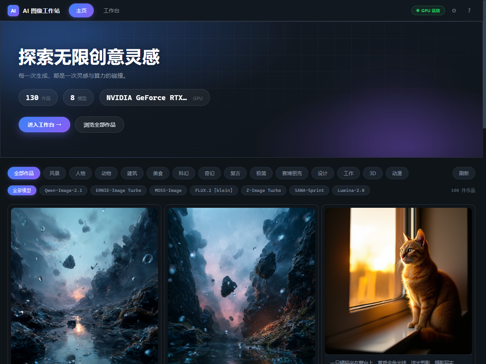
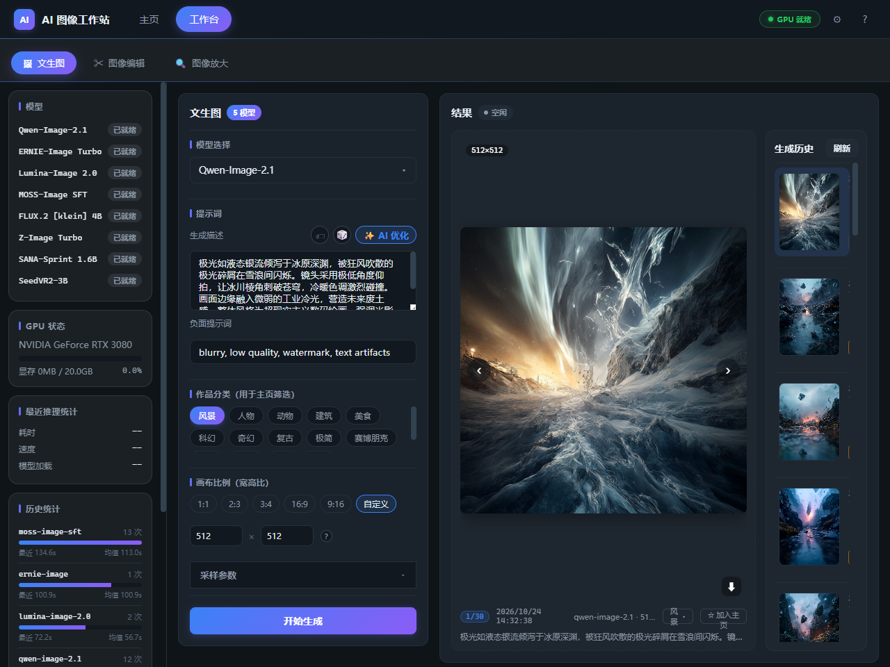
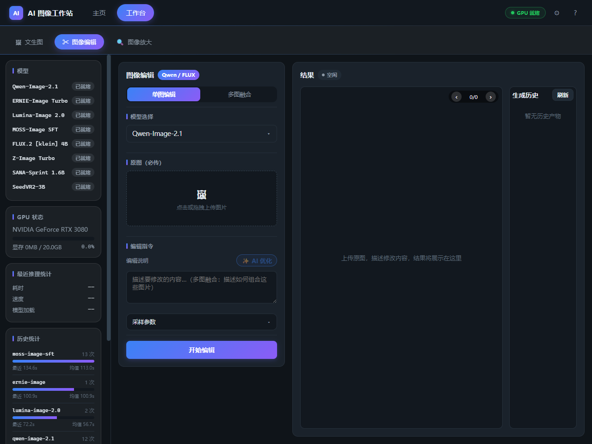
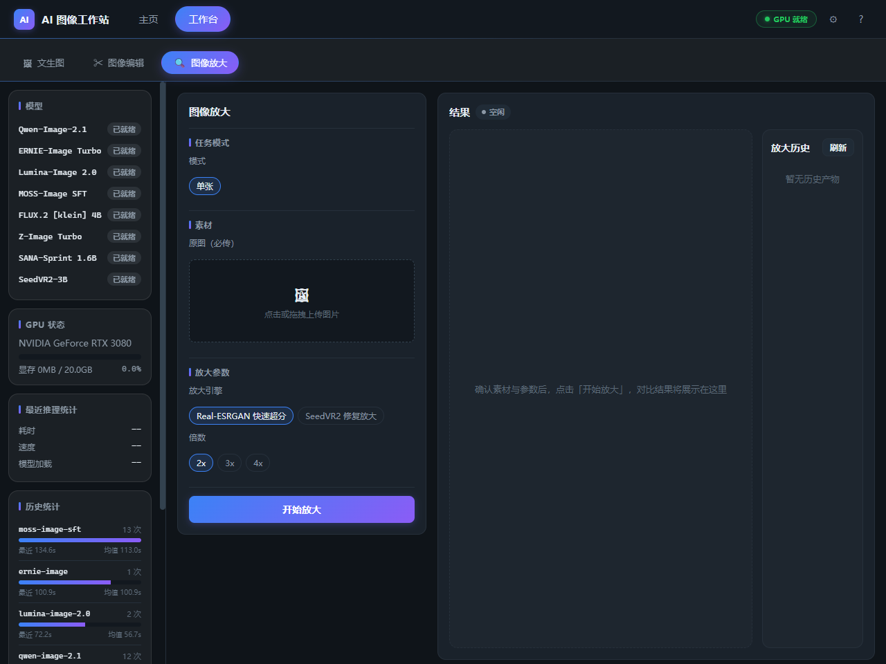

# AI Image Studio（AI 图像工作站）

一个自托管的 GPU 加速图像生成工作站，将 **文生图**、**图像编辑 / 多图融合**、**图像放大** 与 **扩图** 整合在同一个 Web 应用中——由 FastAPI 后端与 Vue 3 + TypeScript 单页前端驱动。

专为单张消费级显卡（如 RTX 3080 20GB）设计，在统一的任务/队列系统下服务多个开源扩散模型：SSE 实时进度、持久化的生成历史，以及可策展的作品主页。

---

## 界面截图

| 主页 / 作品库 | 文生图 |
| --- | --- |
|  |  |

| 图像编辑 | 图像放大 |
| --- | --- |
|  |  |

---

## 功能特性

### 🎨 文生图
- 运行时可切换 **7 个生成模型**：Qwen-Image-2.1、ERNIE-Image Turbo（INT8）、Lumina-Image 2.0、MOSS-Image SFT、FLUX.2 [klein] 4B、Z-Image Turbo、SANA-Sprint 1.6B。
- 画布预设（1:1、2:3、3:4、16:9、9:16）**以及自定义分辨率**（32 倍数校验，上限 2048px）。
- 负面提示词、采样步数、随机种子与作品**分类**标签。
- **AI 提示词优化**（本地 LLM）与**随机提示词**生成器。

### 🖌️ 图像编辑
- 通过自然语言指令进行**单图编辑**。
- **多图融合**——九宫格上传，最多 9 张参考图，通过提示词融合。
- 模型选择器只显示支持编辑的模型；编辑前后对比展示。

### 🔍 图像放大
- **放大引擎**：Real-ESRGAN（ncnn-vulkan 快速超分，秒级，不占 CUDA 显存），支持 2x / 3x / 4x。
- 交互式**前后对比滑块**（左原图、右放大图）。

### 🖼️ 扩图
- 基于指令将画面扩展到原始画布之外。

### 🗂️ 作品主页与历史
- 可策展的主页作品库：分类筛选、置顶/取消置顶、逐图分类编辑。
- 各工具独立的生成历史：参数、耗时、模型、尺寸；点击回显预览与参数；左右键快速切换。

### ⚙️ 任务系统
- 单 worker 任务队列，**SSE 实时进度**，排队/进行中/成功/失败状态；模型按需加载/卸载以控制显存；重启后任务状态保留。

---

## 技术栈

| 层级 | 技术 |
| --- | --- |
| 后端 | Python 3.12 · FastAPI · uvicorn · Pydantic v2 |
| 推理 | PyTorch 2.11（CUDA 12.8）· Transformers · Diffusers · bitsandbytes（int4/int8） |
| 前端 | Vue 3 · TypeScript · Vite · Vue Router · Pinia |
| 存储 | 本地 JSON 存储（作品/主页/历史）+ 文件系统输出 |
| 模型 | Hugging Face / ModelScope 权重（本地运行，无外部 API） |

---

## 环境构筑手顺（从零开始）

### 1. 前置条件

- **显卡**：NVIDIA RTX 3080 / 3090（20–24GB 显存）或更高，驱动较新。
- **系统**：Windows 10/11（或 Linux）——以下为 Windows + PowerShell 的实测步骤。
- **软件**：Python **3.12+**、Node.js **18+** / npm、Git。

### 2. 后端环境

```powershell
# 创建虚拟环境
python -m venv .venv
.\.venv\Scripts\Activate.ps1

# 先装 PyTorch CUDA 版（Windows 下 PyPI 默认是 CPU 版）
pip install torch torchvision --index-url https://download.pytorch.org/whl/cu128

# 再装其余依赖
pip install -r requirements.txt
```

`requirements.txt` 包含：transformers ≥5.17、diffusers ≥0.41、accelerate、pillow、huggingface_hub、einops、omegaconf、mediapy、opencv-python、rotary-embedding-torch、modelscope、pytest。

### 3. 下载模型权重

将模型权重放在项目 `models/` 目录下。后端从 `backend/app/config.py` 解析各模型路径（如 `models/Qwen-Image-2.1`）。可用 ModelScope CLI 下载：

```powershell
pip install modelscope
modelscope download --model <model-id> --local_dir models\<模型目录名>
```

所需模型：

| 目录（`models/`） | 模型 |
| --- | --- |
| `Qwen-Image-2.1` | Qwen-Image-2.1（文生图、编辑） |
| `ERNIE-Image-INT8` | ERNIE-Image Turbo（INT8） |
| `Lumina-Image-2.0` | Lumina-Image 2.0 |
| `MOSS-Image-SFT` | MOSS-Image SFT |
| `FLUX.2-klein-4B` | FLUX.2 [klein] 4B |
| `Z-Image-Turbo` | Z-Image Turbo |
| `Sana-Sprint-1.6B` | SANA-Sprint 1.6B |
| `Qwen3.5-4B-Instruct` | 本地 LLM（提示词优化） |


### 4. 前端

```powershell
cd frontend
npm install
npm run build      # 生产构建到 frontend/dist
# 或
npm run dev        # 开发服务器（默认 http://localhost:5173）
```

### 5. 启动后端

```powershell
cd backend
$env:PYTHONPATH = "E:\路径\到\项目\.venv\Lib\site-packages;E:\路径\到\项目\backend"
..\.venv\Scripts\python.exe -m uvicorn app.main:app --host 0.0.0.0 --port 8001
```

打开 **http://localhost:8001** —— 前端由同一后端从 `frontend/dist` 提供（单端口部署）。

> 说明：`config.py` 默认端口为 8000；以上实测命令使用 8001，两者皆可——保持一致即可。

### 6. 健康检查

```powershell
Invoke-RestMethod http://127.0.0.1:8001/api/health
# {"status":"ok","version":"0.1.0"}

Invoke-RestMethod http://127.0.0.1:8001/api/models
# -> 模型列表（含加载状态与 GPU 显存统计）
```

---

## API 一览

| 方法 | 路径 | 说明 |
| --- | --- | --- |
| GET | `/api/health` | 健康检查 |
| GET | `/api/models` | 模型列表、GPU/显存统计、加载状态 |
| GET | `/api/models/stats` | 推理统计 |
| POST | `/api/tasks/text-to-image` | 提交文生图任务 |
| POST | `/api/tasks/edit` | 提交图像编辑 / 多图融合（multipart） |
| POST | `/api/tasks/outpaint` | 提交扩图任务 |
| POST | `/api/tasks/upscale` | 提交放大任务（Real-ESRGAN） |
| GET | `/api/tasks` | 任务列表 |
| GET | `/api/tasks/{task_id}` | 任务详情（状态、进度、输出、耗时） |
| GET | `/api/tasks/{task_id}/events` | SSE 进度流 |
| GET | `/api/outputs` | 输出批次列表 |
| GET | `/api/outputs/{stamp}/{image}` | 生成图片服务 |
| POST | `/api/gallery/pin` / `/unpin` | 置顶 / 取消置顶作品 |
| POST | `/api/gallery/category` | 更新作品分类 |
| POST | `/api/prompt/optimize` | LLM 提示词优化 |
| POST | `/api/prompt/random` | 随机提示词 |

---

## 项目结构

```
├── backend/
│   ├── app/
│   │   ├── main.py              # FastAPI 入口（挂载静态前端）
│   │   ├── config.py            # 路径、端口、限制
│   │   ├── schemas.py           # Pydantic 请求/响应模型
│   │   ├── task_manager.py      # 任务队列 + SSE 进度
│   │   ├── routers/             # models / tasks / outputs / gallery / prompt
│   │   └── services/            # 各模型推理服务
│   └── requirements.txt
├── frontend/
│   ├── src/
│   │   ├── views/               # Home、TextToImage、EditImage、Upscale、Outpaint
│   │   ├── components/          # ModelSelector、HistoryGallery、BeforeAfterSlider 等
│   │   ├── router/ · stores/ · api/ · utils/ · types/
│   └── package.json
├── models/                      # 本地模型权重（不纳入版本控制）
├── outputs/                     # 生成图片，按时间戳分批
├── db/                          # JSON 存储（作品 / 主页 / 历史）
├── utils/                       # 模型工具封装（qwen_21_util、realesrgan_util 等）
├── docs/                        # 集成与运维记录
└── tests/
```

---

## 配置说明

`backend/app/config.py` 中的关键配置：

| 配置项 | 默认值 | 含义 |
| --- | --- | --- |
| `OUTPUT_DIR` | `outputs/` | 生成图片输出根目录 |
| `MAX_UPLOAD_MB` | 20 | 单文件上传大小上限 |
| `MAX_TASK_PIXELS` | 4,000,000 | 生成面积上限（防 OOM） |
| `HOST` / `PORT` | 127.0.0.1 / 8000 | 服务器默认地址（可由 uvicorn 参数覆盖） |

---

## 说明与许可

- 本项目为本地研究/开发工作站；所用模型均为第三方开源权重，各自适用其许可证（Apache-2.0 / Community / 模型特定条款）。生产使用前请确认商用条款。
- 生成图片存放于 `outputs/<时间戳>/`，附带 `input_prompt.txt` 记录提示词、模型与参数。
- 各模型的集成历程与排障说明见 `docs/` 目录（如 Real-ESRGAN、Lumina-Image 2.0、HiDream 等）。
