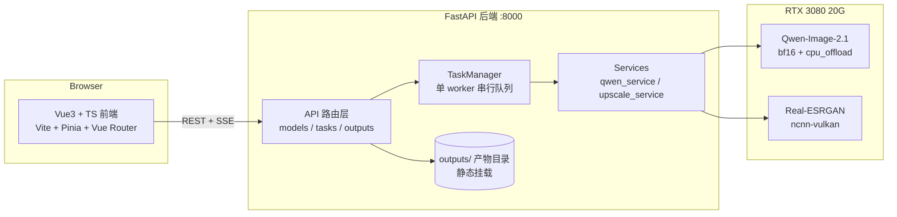
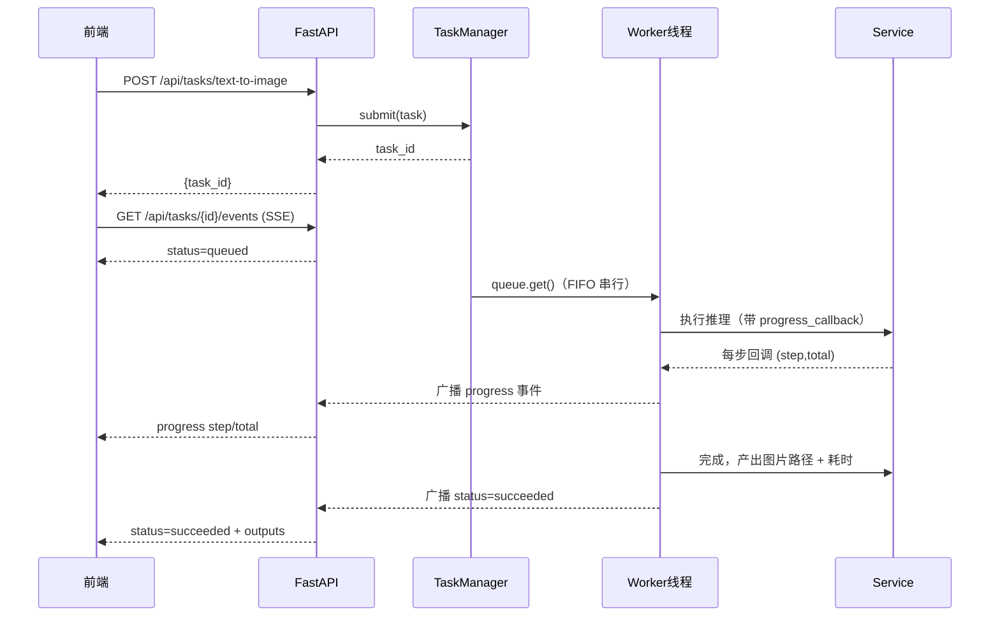

# 02 · 系统架构设计

> 版本：v0.1 · 2026-10-21

## 1. 总体架构（前后端分离）



要点：
- **前端只与 API 交互**，不直接接触模型与文件系统。
- **推理串行化**：TaskManager 内单 worker 线程从队列取任务执行，天然避免并发显存竞争。
- **进度实时性**：任务执行中通过 SSE 通道推送 `progress` / `status` 事件；前端 `EventSource` 订阅。
- **产物即输出规范**：复用 `outputs/YYYYMMDD_hhmmss/input_prompt.txt + output_xx.png`，
  后端静态挂载 `outputs/` 供画廊与下载。

## 2. 目录结构

```
qwen-2.1/
├── docs/                          # 本文档集
│   ├── 01-需求与功能设计.md
│   ├── 02-系统架构设计.md
│   ├── 03-后端API设计.md
│   ├── 04-前端设计.md
│   └── 05-部署与运维.md
├── backend/
│   ├── app/
│   │   ├── __init__.py
│   │   ├── main.py                # FastAPI 入口、静态托管、CORS
│   │   ├── config.py              # 路径/端口/模型目录常量
│   │   ├── schemas.py             # Pydantic 请求/响应模型
│   │   ├── task_manager.py        # 任务队列、SSE 广播
│   │   ├── routers/
│   │   │   ├── models.py          # 模型/GPU 状态
│   │   │   ├── tasks.py           # 任务提交与查询、SSE
│   │   │   └── outputs.py         # 历史输出列表
│   │   └── services/
│   │       ├── qwen_service.py    # 封装 utils.qwen_21_util（含进度回调）
│   │       └── upscale_service.py # 封装 utils.realesrgan_util（ncnn-vulkan 超分）
│   ├── requirements.txt
│   └── run.py                     # uvicorn 启动脚本
├── frontend/
│   ├── src/
│   │   ├── main.ts / App.vue
│   │   ├── router/index.ts
│   │   ├── stores/                # Pinia：task / model
│   │   ├── api/client.ts          # fetch + SSE 封装
│   │   ├── types/index.ts         # 与后端 schema 对齐的 TS 类型
│   │   ├── views/                 # 四功能页
│   │   ├── components/            # 侧栏/画廊/进度条/参数控件
│   │   └── styles/                # 深色主题变量
│   ├── vite.config.ts / tsconfig.json / package.json
│   └── index.html
├── utils/                         # 既有封装（只增不改）
├── models/                        # 模型权重（Qwen/ERNIE/MOSS/FLUX.2/Z-Image/SANA/Lumina + realesrgan 二进制）
├── outputs/                       # 全部产物（历史画廊数据源）
└── tests/
```

## 3. 任务队列设计（TaskManager）



- **队列结构**：`queue.Queue` + 常驻 daemon worker 线程（进程内唯一）。
- **任务对象**：`TaskInfo(id, type, status, progress, message, outputs, elapsed, error, created_at)`。
- **失败处理**：异常捕获 → `status=failed` + error 信息；worker 不退出，继续消费下一条。
- **进度回调**：`utils` 新增可选 `progress_callback(step, total)` 参数（Qwen 扩散步进；
  Real-ESRGAN 阶段文本映射为 0~100 的近似进度）。
- **SSE 广播**：每个任务一个 `asyncio.Queue`；GET events 时由 sse-starlette 转发；
  任务结束发送 `done` 事件并关闭流。

## 4. 显存与并发策略（3080 20G）

| 策略 | 实现 |
|---|---|
| 串行推理 | 单 worker 队列，天然互斥 |
| Qwen | bf16 + `enable_model_cpu_offload()`（util 已有） |
| Real-ESRGAN | ncnn-vulkan 推理，不占 CUDA 显存；2x/3x/4x 由 x4plus 超分 + LANCZOS 缩放实现 |
| 懒加载 | 模型首次任务触发时加载，`model_load_seconds` 计入任务耗时统计 |
| 上传限制 | 单图 ≤ 20MB，仅 png/jpg/jpeg/webp |

## 5. 数据流（一次文生图请求）

1. 前端校验参数 → `POST /api/tasks/text-to-image`
2. 后端生成 `task_id` 入队，立即返回
3. 前端 `EventSource` 订阅 `GET /api/tasks/{id}/events`
4. Worker 执行 → 每步广播 `progress` → 完成后广播 `succeeded` + `outputs` 路径
5. 前端画廊渲染结果图（`/api/outputs/...` 静态路径），展示耗时

## 6. 错误码约定

| code | 含义 |
|---|---|
| `TASK_NOT_FOUND` | 任务 ID 不存在 |
| `TASK_BUSY` | 队列已满（暂不限制，默认无上限，但提示串行等待） |
| `INVALID_PARAM` | 参数校验失败（宽高比/步数/图片格式等） |
| `MODEL_LOAD_FAILED` | 模型加载失败 |
| `INFERENCE_FAILED` | 推理失败（含 OOM，message 附显存信息） |
| `UPLOAD_INVALID` | 上传文件非法 |
